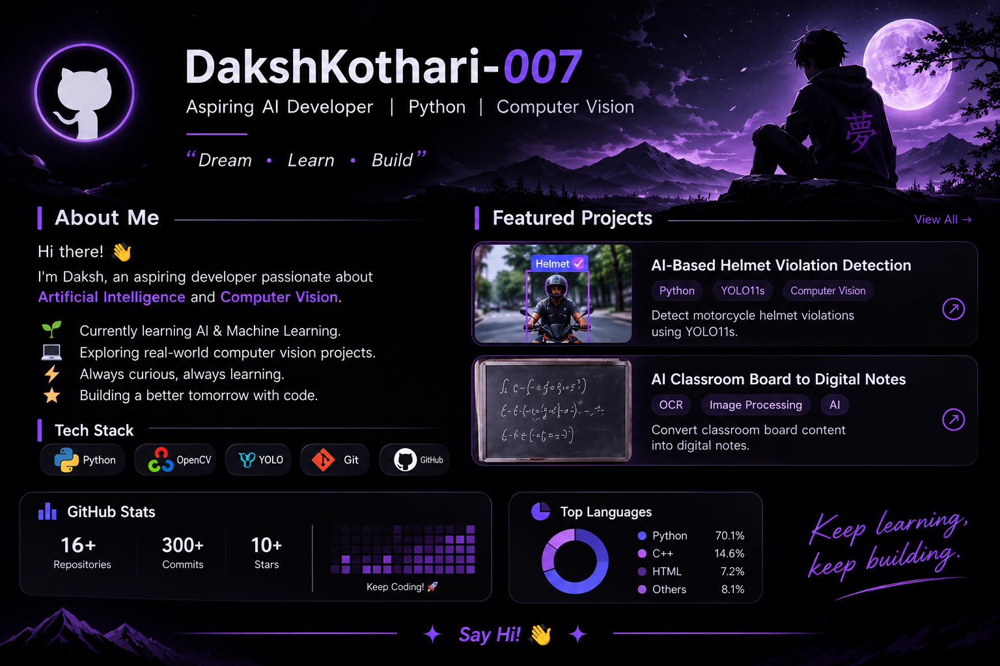

 

### `Dream • Learn • Build`

---

## 👋 About Me

Hi, I'm **Daksh Kothari**.

An aspiring developer passionate about **Artificial Intelligence and Computer Vision**.

- 🌱 Currently learning AI and Machine Learning.
- 💻 Exploring Python and Computer Vision.
- 🚀 Building projects and learning new technologies.
- ⚡ Always curious, always improving.

---

## 🛠️ Tech Stack

 

---

## 🚀 Featured Projects

<table>
<tr>
<td width="50%" valign="top">

### 🪖 AI Helmet Violation Detection

**Computer Vision | YOLO11s | Python**

An AI-based project focused on detecting motorcycle helmet violations.

- Object detection
- Image and video processing
- YOLO11s model

</td>
<td width="50%" valign="top">

### 📝 AI Classroom Board to Digital Notes

**AI | OCR | Image Processing**

Exploring a system to convert classroom board content into digital notes.

- Text extraction
- Handwriting recognition
- Image processing

</td>
</tr>
</table>

---

## 📊 GitHub Statistics

  

---

## 🌙 Currently Learning

- Python programming
- Machine Learning
- Deep Learning
- Computer Vision
- Object Detection

---

### 💜 Keep Learning. Keep Building.

*Every expert was once a beginner.*

### 👋 Say Hi!

